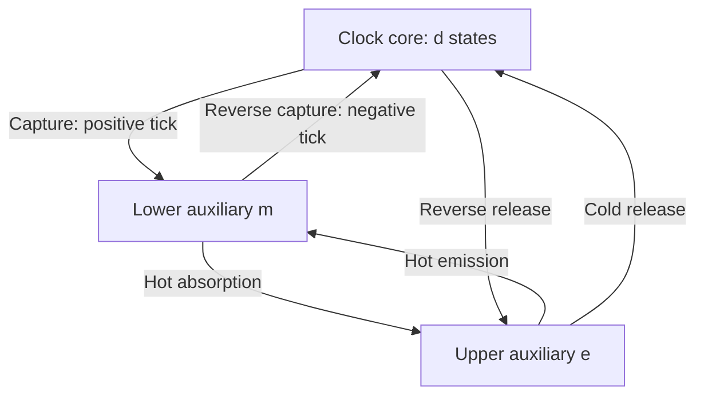

# What a finite reset changes

A clock must prepare itself for another tick. An ideal reset map can hide the time, noise and thermodynamic bias required for that preparation. The construction studied here retains a simple thermal recycling stage as part of the clock and proves that its contribution can be controlled under the same event-rate budget as the core.

## The cycle

The coherent core evolves until a capture sends it to an auxiliary state $`m`$. A hot transition raises it to $`e`$, from which a cold release prepares the core's initial state $`\psi`$. Every thermal transition also has its reverse.



The arrows aggregate the channels listed in the [model](model.md). Capture can have several channels, but every positive capture prepares the same state $`m`$. Thus it marks an exact regeneration point even when reverse events are present. No controller waits for a measured outcome and applies a later pulse; the specified generator is time independent.

## Precision must be paired with the period

For an ordinary renewal clock with mean interval $`\mu`$ and variance $`\sigma^2`$,

```math
P=\frac{\mu^2}{\sigma^2},\qquad
j=\frac1\mu,\qquad
D_{\rm time}=\frac{\sigma^2}{\mu}=\frac1{jP}.
```

Increasing precision by stretching the period need not improve an elapsed-time estimate. The relevant combination is $`jP`$: it controls how much variance the calibrated count acquires per unit duration. For the compiled quantum family, $`j=\Theta(g/d)`$ while $`P\ge c_\eta d^{2-\eta}`$, so $`gD_{\rm time}=O(d^{-1+\eta})`$ decreases.

At finite reverse rate the count is signed and is not an ordinary renewal count. The same identity $`D_{\rm time}=1/(jP)`$ still follows from the definitions, but the interval formula for $`P`$ must be replaced by the [joint reward calculation](counting_statistics.md). A block can contain negative captures before its final positive capture. Their correlation with its length matters.

## The reference reset has a real noise cost

With cold reverse channels switched off and the hot ratio $`h`$ held fixed, the return time $`R_h`$ has

```math
\mathbb ER_h=\frac{2/h+1}{g},\qquad
\mathrm{Var}R_h=\frac{4/h^2+2/h+1}{g^2}.
```

For $`h=1/2`$, these are $`5/g`$ and $`21/g^2`$. The full reference interval is the independent sum of the reset duration and the core interval. Consequently,

```math
F_0=\frac{\sigma^2+21/g^2}{(\mu+5/g)^2}
\quad\text{when }h=1/2.
```

The reset noise is finite and explicitly present. A quasiideal core has mean of order $`d/g`$ and variance at most order $`d^\eta/g^2`$. A constant reset variance fits within that allowance. With two fixed bath temperatures, the return is slower, but its variance still fits when the temperature contrast is chosen for the desired exponent loss.

Cold reverse events require more than this independent-sum calculation. A reverse capture can prepare a core state different from $`\psi`$ and generate a long excursion. The theorem therefore bounds the mean absorption time from **every** core state through $`B_C`$. The quasiideal source has $`B_C\le d^3/g`$ because its capture effect has a small positive floor. An inverse-polynomial reverse rate can then suppress the perturbation of both duration and signed-count moments. Eventual absorption without a quantitative bound would not justify the same logarithmic-cost conclusion.

## Why the thermal cost is logarithmic

A cold upward/downward ratio $`z=d^{-11}`$ costs $`\log(1/z)=11\log d`$ in dimensionless bias. There are two cold downward steps per net cycle and one hot upward step. Occupation conservation gives exactly

```math
\Sigma=2\log(1/z)-\log(1/h).
```

Repeated failed hot excursions and reverse cycles are included: their signed heat contributions cancel except for endpoint occupations. This heat identity alone is established thermodynamic bookkeeping. Its useful consequence here comes from the [finite-rate theorem](finite_rate_recycling.md), which proves that the expanded device retains the desired timing statistics at that bias.

Two fixed temperatures require gaps that grow as $`\log d`$. Fixed gaps instead require a progressively colder bath. Neither implementation keeps temperatures, gaps, reset duration and microscopic engineering requirements all fixed while taking the dimension limit. The [resource ledger](thermodynamics.md#4-two-distinct-ways-to-obtain-logarithmic-entropy) states the two consistent choices.

## The comparison and its boundary

Under the full event-rate cap $`2g`$, a classical Markov clock can improve tick precision by using a longer multistage cycle, but its calibrated time diffusion stays at least $`1/(2g)`$. The quantum core retains coherent evolution between jumps and can cross that benchmark after recycling is included. Both sides are compared using their actual mean current and the same count-based output convention.

The established gap is cyclic reset within the stated thermal Markov model: auxiliary memory, finite return time, reverse-event noise, complete event activity and stationary bath entropy are included. Static reservoir engineering and its weak-coupling limit remain model assumptions. Detector operation, finite output-memory erasure, learning an unknown current and maintaining reservoirs require their own resource analyses. The proof provides a specific component of a complete clock-cost account, with a precise operational advantage at that component's stated scope.
